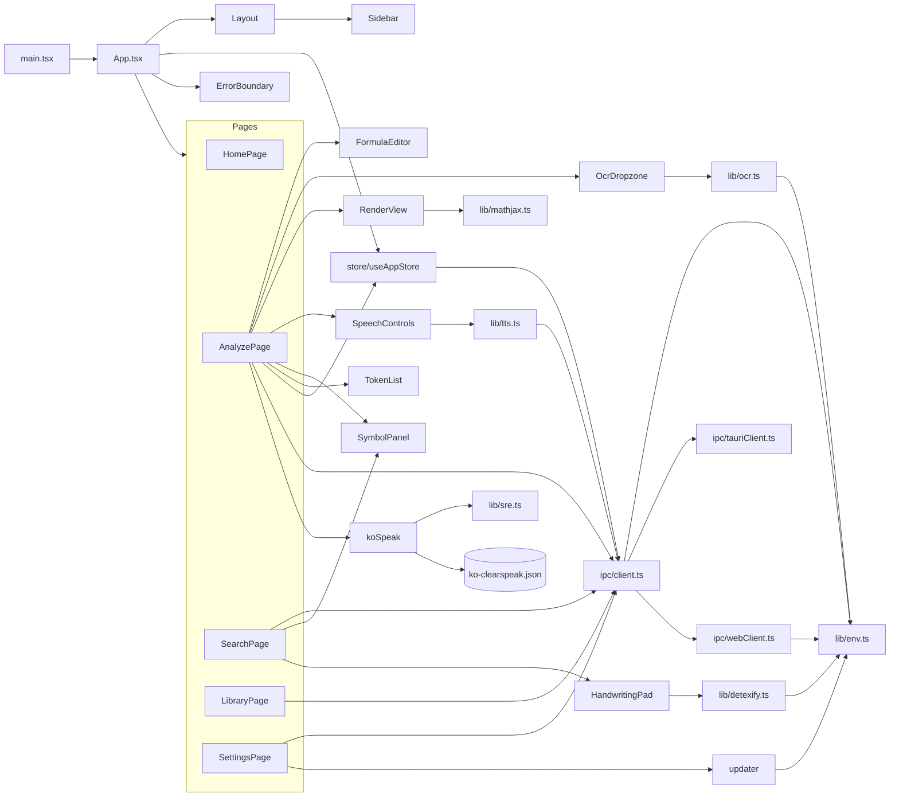
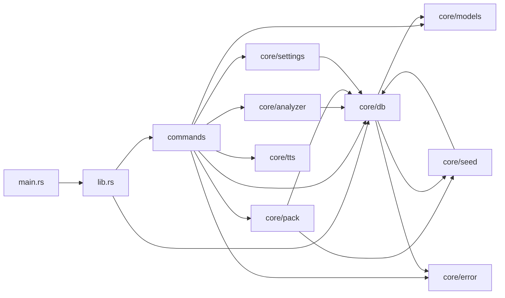
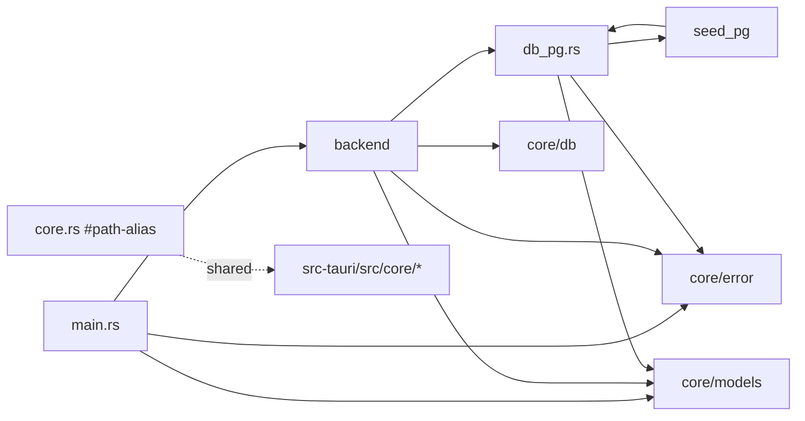
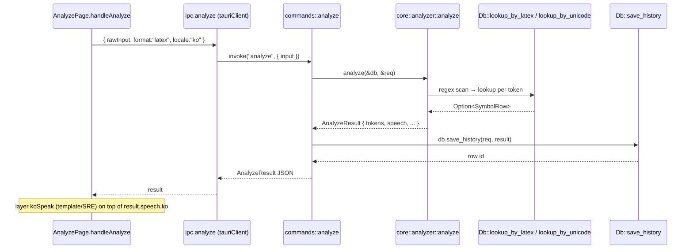
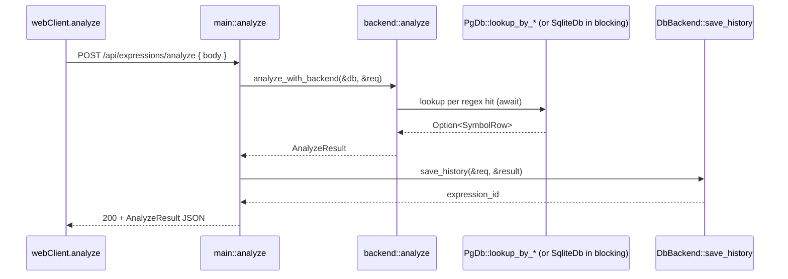
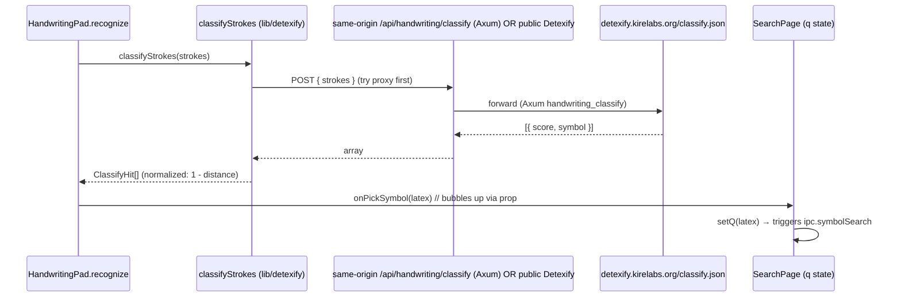

# 코드 단위 리뷰 보고서 / Line-by-Line Code Review

> 분석일 / Analysis Date: 2026-05-20
> 대상 / Target: `/Users/wise/Developer/NGL(Go,Rust,...)/NSF-Reading-Helper`
> 리뷰 레벨 / Review Level: **2** — 약 3년 경력 주니어 개발자 / ~3 yrs experience junior developer
> 선택 파일 수 / Files Reviewed: **40 / ~52** source files
> 분석 / Analyst: Claude (Anthropic), `code-review-by-levels` skill

---

## 1. 작업공간 인벤토리 / Workspace Inventory

### 1.1 디렉토리 트리 (depth 4) / Directory Tree

```
NSF-Reading-Helper/
├── README.md, README-Web.md, Usage.md, CODE_SIGNING.md
├── package.json                            (root manifest, pnpm@10.33.0)
├── pnpm-lock.yaml
├── tsconfig.json, tsconfig.node.json, vite.config.ts, tailwind.config.js, postcss.config.js
├── index.html                              (Vite entry HTML)
├── docker-compose.yml                      (web + ocr + nginx stack)
├── docker-compose.local.yml
├── Dockerfile.web, Dockerfile.web-frontend, Dockerfile.ocr
├── .env.example, .dockerignore, .gitignore
├── .github/workflows/release.yml           (multi-target Tauri build CI)
├── .doc/                                   PRD + reference docs
├── .tools/                                 seed expander scripts
├── data/                                   (runtime data placeholder)
├── deploy/nginx.app.conf                   nginx reverse proxy
├── ocr/                                    Python FastAPI pix2tex sidecar
│   ├── main.py
│   └── requirements.txt
├── public/                                 PWA assets (manifest, sw.js, icons)
├── src/                                    React frontend
│   ├── main.tsx, App.tsx, types.ts, index.css, vite-env.d.ts
│   ├── components/                         (11 .tsx files)
│   ├── hooks/                              (empty / future)
│   ├── ipc/                                client.ts, tauriClient.ts, webClient.ts
│   ├── lib/                                (11 .ts files + ko-clearspeak.json)
│   ├── pages/                              5 page components
│   ├── store/                              useAppStore.ts (Zustand)
│   └── types/                              (placeholder)
├── src-tauri/                              Rust desktop (Tauri 2)
│   ├── Cargo.toml, Cargo.lock, build.rs, tauri.conf.json
│   ├── capabilities/default.json
│   ├── data/seed.json                      Embedded seed dictionary
│   ├── gen/schemas/...
│   ├── icons/...
│   └── src/
│       ├── main.rs, lib.rs, commands.rs
│       └── core/
│           ├── mod.rs, db.rs, models.rs, analyzer.rs,
│           ├── pack.rs, seed.rs, error.rs, settings.rs, tts.rs
└── web-server/                             Rust HTTP server (Axum)
    ├── Cargo.toml, Cargo.lock
    ├── migrations/postgres.sql
    └── src/
        ├── main.rs, backend.rs, core.rs, db_pg.rs, seed_pg.rs
```

### 1.2 파일 수 / File Counts

| 카테고리 / Category | 개수 / Count |
|---|---|
| TypeScript/TSX (src/) | 36 |
| Rust (src-tauri/, web-server/) | 13 |
| Python (ocr/) | 1 |
| SQL migrations | 1 (`web-server/migrations/postgres.sql`) |
| Dockerfile | 3 |
| Compose | 2 |
| Nginx config | 1 |
| Workflow | 1 |
| Seed data (JSON) | 1 (`src-tauri/data/seed.json`, embedded at compile time) |

### 1.3 빌드·의존 매니페스트 / Build & Dependency Manifests

- `package.json` — pnpm workspace single-project; scripts: `dev`, `build`, `tauri:dev`, `tauri:build:{mac,win,linux}`, `typecheck`. Engines: `node >= 20`.
- `src-tauri/Cargo.toml` — Tauri 2 with `protocol-asset`, plugins (`dialog`, `fs`, `opener`, `updater`), bundled rusqlite, regex, tokio.
- `web-server/Cargo.toml` — Axum 0.7, tokio-postgres + deadpool, tokio, reqwest (for Detexify proxy), rusqlite (shared parity).
- `ocr/requirements.txt` — FastAPI 0.115.5, uvicorn, Pillow, **CPU-only torch 2.5.1**, pix2tex 0.1.5.
- `tsconfig.json`, `vite.config.ts`, `tailwind.config.js`, `postcss.config.js` — standard Vite+React+Tailwind toolchain.

### 1.4 락 파일 / Lockfiles

`pnpm-lock.yaml`, `src-tauri/Cargo.lock`, `web-server/Cargo.lock` — all present.

### 1.5 진입점 후보 / Entrypoint Candidates

| # | 진입점 / Entry | 종류 / Kind |
|---|---|---|
| 1 | `src/main.tsx` | Vite/React 클라이언트 부팅 |
| 2 | `src-tauri/src/main.rs` → `nsf_reading_helper_lib::run()` | Tauri 데스크톱 바이너리 |
| 3 | `src-tauri/src/lib.rs::run` | Tauri Builder 셋업 + IPC 등록 |
| 4 | `web-server/src/main.rs::main` | Axum HTTP 서버 (`tokio::main`) |
| 5 | `ocr/main.py` (FastAPI `app`) | uvicorn 실행 OCR 사이드카 |
| 6 | `index.html` | Vite HTML 셸 (`/src/main.tsx` 참조) |
| 7 | `public/sw.js` | PWA 서비스 워커 (런타임 등록, 미선택) |

### 1.6 테스트 디렉토리 / Test Directories

**확인 불가 — 전용 테스트 디렉토리 부재 / Not found — no dedicated test directories.**
The project has no `tests/`, `__tests__/`, `*.test.{ts,tsx}`, or `#[cfg(test)] mod tests {}` blocks visible in the read set. Test coverage signal at the file level is **모두 "없음 / none"**. Documented in [section 7.5](#75-테스트-공백--test-gaps).

---

## 2. 프로젝트 구조 / Project Structure

### 2.1 소스 트리 (역할 주석 포함) / Source Tree with Roles

```
src/                                  React PWA / Tauri webview client
├── main.tsx                          ReactDOM mount + SW registration
├── App.tsx                           Route tree + bootstrap gate
├── types.ts                          Shared DTOs (mirrors backend models)
├── index.css                         Tailwind + base styles
├── components/                       Presentational + interactive widgets
│   ├── Layout.tsx                    Sidebar + main outlet, mobile drawer, shortcuts
│   ├── Sidebar.tsx                   Left nav
│   ├── HandwritingPad.tsx            Canvas stroke capture → Detexify classify
│   ├── SymbolPanel.tsx               Symbol detail panel (aliases/domains/examples/similar)
│   ├── TokenList.tsx, FormulaEditor.tsx, OcrDropzone.tsx, SpeechControls.tsx,
│   ├── RenderView.tsx, ErrorBoundary.tsx, icons.tsx
├── ipc/                              Backend adapter pattern
│   ├── client.ts                     Static dispatcher (Tauri vs Web)
│   ├── tauriClient.ts                @tauri-apps/api invoke wrappers
│   └── webClient.ts                  fetch wrappers for the Axum API
├── lib/                              Pure modules (no React)
│   ├── env.ts                        isTauri flag, apiBaseUrl()
│   ├── cn.ts                         Tailwind class merger
│   ├── detectFormat.ts               LaTeX/MathML/AsciiMath/Unicode heuristic
│   ├── mathjax.ts                    MathJax v3 lazy loader
│   ├── sre.ts                        Speech Rule Engine wrapper
│   ├── koSpeak.ts                    Korean speech pipeline (template→SRE→tokens)
│   ├── ko-clearspeak.json            Rule pack data
│   ├── tts.ts                        Web SpeechSynthesis / Tauri TTS dispatch
│   ├── ocr.ts                        pix2tex sidecar client
│   ├── detexify.ts                   Detexify classifier client (override/proxy/public)
│   └── updater.ts                    Tauri updater wrapper
├── pages/                            Route screens
│   ├── HomePage.tsx, AnalyzePage.tsx, SearchPage.tsx,
│   ├── LibraryPage.tsx, SettingsPage.tsx
└── store/
    └── useAppStore.ts                Zustand global store

src-tauri/                            Rust desktop (sqlite-backed)
├── src/main.rs                       Bin entry (calls lib::run)
├── src/lib.rs                        Tauri Builder + IPC handlers registry
├── src/commands.rs                   #[tauri::command] surface (analyze, search, …)
└── src/core/                         Pure logic + sqlite IO
    ├── mod.rs                        Module index
    ├── db.rs                         Sqlite schema, search (exact/LIKE/FTS5/levenshtein),
    │                                 history/favorites/notes/settings persistence
    ├── models.rs                     Serde types (camelCase JSON for the webview)
    ├── analyzer.rs                   Regex token extraction + DB lookup
    ├── pack.rs                       .nsfpack zip import/export
    ├── seed.rs                       Compile-time embedded seed installer
    ├── error.rs                      AppError + Serialize impl
    ├── settings.rs                   JSON blob settings KV
    └── tts.rs                        OS TTS shim (say/espeak-ng/PowerShell)

web-server/                           Axum HTTP server, optional Postgres
├── src/main.rs                       Router + ApiError + handlers
├── src/backend.rs                    DbBackend enum: Sqlite(blocking) vs Postgres(native)
│                                     + async analyzer (DB-agnostic) + clone helpers
├── src/core.rs                       #[path]-aliased re-exports of src-tauri/src/core
├── src/db_pg.rs                      tokio-postgres pool + queries (mirrors Sqlite API)
├── src/seed_pg.rs                    Postgres seed installer (shares seed.json)
└── migrations/postgres.sql           pg_trgm + fuzzystrmatch + tables

ocr/                                  FastAPI sidecar (pix2tex)
├── main.py                           /healthz + /ocr/predict
└── requirements.txt                  pinned CPU-only torch
```

### 2.2 모듈·패키지 의존 그래프 / Module & Package Dependency Graph

**프론트엔드 / Frontend**


**Tauri 데스크톱 (src-tauri) / Tauri Desktop**


**웹 서버 (web-server) / Web Server**


### 2.3 호출·응답 흐름도 / Call & Response Flow

**시퀀스 1 — 데스크톱 `analyze` 호출 / Desktop `analyze` IPC**


**시퀀스 2 — 웹 `POST /api/expressions/analyze` / Web analyze**


**시퀀스 3 — Handwriting → Detexify → 검색 / Handwriting → Detexify → Search**


### 2.4 외부 패키지 인벤토리 / Third-Party Package Inventory

> 행이 많아 코어 의존만 표로 두고, 전체 트랜지티브 카운트는 본문 끝에 메모합니다.
> 사용처는 `import`/`use` 식별자 grep으로 확인했습니다.

#### Node (frontend)

| 패키지 / Package | 버전 / Version | 사용처 / Used In | 역할 / Purpose | 라이선스 / License |
|---|---|---|---|---|
| react | ^19.1.0 | 모든 컴포넌트·페이지 (.tsx) | UI 런타임 | MIT |
| react-dom | ^19.1.0 | `src/main.tsx` | DOM 렌더링 | MIT |
| react-router-dom | ^7.14.1 | `src/main.tsx`, `App.tsx`, `Layout.tsx`, `HomePage.tsx` | 클라이언트 라우팅 | MIT |
| zustand | ^5.0.12 | `src/store/useAppStore.ts` | 글로벌 스토어 | MIT |
| clsx | ^2.1.1 | `src/lib/cn.ts` | 클래스명 결합 | MIT |
| tailwind-merge | ^3.5.0 | `src/lib/cn.ts` | Tailwind 클래스 충돌 머지 | MIT |
| mathjax-full | ^3.2.2 | (미사용 — `lib/mathjax.ts`는 CDN 스크립트 로드) | (가능: 향후 번들 사용) | Apache-2.0 |
| speech-rule-engine | ^4.1.2 | `src/lib/sre.ts` (dynamic import) | LaTeX → 음성 텍스트 | Apache-2.0 |
| @tauri-apps/api | ^2 | `src/ipc/tauriClient.ts` | invoke() | MIT/Apache-2.0 |
| @tauri-apps/plugin-dialog | ^2.7.0 | `src/pages/SettingsPage.tsx` (dynamic) | open/save 다이얼로그 | MIT/Apache-2.0 |
| @tauri-apps/plugin-fs | ^2.5.0 | (의존성 등록만; 직접 import 없음) | (Tauri 권한 시스템 기반) | MIT/Apache-2.0 |
| @tauri-apps/plugin-opener | ^2 | (의존성 등록만) | URL/파일 외부 열기 | MIT/Apache-2.0 |
| @tauri-apps/plugin-updater | ^2 | `src/lib/updater.ts` (dynamic) | 자동 업데이트 | MIT/Apache-2.0 |
| typescript | ~5.8.3 | dev | 타입 체크 | Apache-2.0 |
| vite | ^7.0.4 | dev | 번들러/devserver | MIT |
| @vitejs/plugin-react | ^4.6.0 | `vite.config.ts` (미선택) | React fast refresh | MIT |
| tailwindcss | ^3.4.19 | dev (CSS pipeline) | 유틸리티 CSS | MIT |
| autoprefixer | ^10.5.0 | dev (postcss) | 벤더 prefix | MIT |
| postcss | ^8.5.10 | dev | CSS 파이프라인 | MIT |
| @types/react, @types/react-dom | ^19.1.x | dev | 타입 정의 | MIT |
| @tauri-apps/cli | ^2 | dev | tauri build | MIT/Apache-2.0 |

**전체 노드 트랜지티브 의존: `pnpm-lock.yaml` 기준 — 본 리뷰에선 직접 의존만 표기.**

#### Rust (`src-tauri/Cargo.toml`)

| 패키지 / Package | 버전 / Version | 사용처 / Used In | 역할 / Purpose | 라이선스 |
|---|---|---|---|---|
| tauri | ^2 (feat `protocol-asset`) | `src-tauri/src/lib.rs`, `commands.rs` | 데스크톱 셸 | MIT/Apache-2.0 |
| tauri-plugin-opener | ^2 | `lib.rs` Builder | URL/파일 열기 | MIT/Apache-2.0 |
| tauri-plugin-dialog | ^2 | `lib.rs` Builder | 파일 다이얼로그 | MIT/Apache-2.0 |
| tauri-plugin-fs | ^2 | `lib.rs` Builder | FS 권한 | MIT/Apache-2.0 |
| tauri-plugin-updater | ^2 | `lib.rs` Builder | 자동 업데이트 | MIT/Apache-2.0 |
| zip | "0.6" | `core/pack.rs` | .nsfpack 압축/해제 | MIT |
| serde | ^1 (derive) | `core/models.rs`, `core/pack.rs`, `core/seed.rs`, `core/error.rs` | (역)직렬화 | MIT/Apache-2.0 |
| serde_json | ^1 | 위와 동일 + `core/db.rs` (tags) | JSON | MIT/Apache-2.0 |
| tokio | ^1 (full) | `core/tts.rs` | 비동기 런타임 | MIT |
| rusqlite | ^0.32 (bundled, functions) | `core/db.rs` | Sqlite ORM-less | MIT |
| anyhow | ^1 | `core/error.rs` From-impl | 동적 오류 | MIT/Apache-2.0 |
| thiserror | ^2 | `core/error.rs` | enum 오류 | MIT/Apache-2.0 |
| dirs | ^5 | (직접 import 없음 — Tauri의 path API 사용) | (사용 없음 / unused) | MIT/Apache-2.0 |
| once_cell | ^1 | `core/analyzer.rs` | Lazy regex | MIT/Apache-2.0 |
| parking_lot | ^0.12 | (직접 import 없음 — `std::sync::Mutex` 사용) | (사용 없음 / unused) | MIT/Apache-2.0 |
| tracing | ^0.1 | `lib.rs`, `core/seed.rs`, `core/pack.rs` | 로그 | MIT |
| tracing-subscriber | ^0.3 (env-filter) | `lib.rs` | 로그 출력 | MIT |
| regex | ^1 | `core/analyzer.rs` | LaTeX 토큰 정규식 | MIT/Apache-2.0 |
| unicode-normalization | ^0.1 | (직접 import 없음) | (사용 없음 / unused) | MIT/Apache-2.0 |

#### Rust (`web-server/Cargo.toml`)

| 패키지 / Package | 버전 | 사용처 | 역할 | 라이선스 |
|---|---|---|---|---|
| axum | ^0.7 (macros) | `web-server/src/main.rs` | HTTP 라우터 | MIT |
| tokio | ^1 (full) | 동일 | 비동기 런타임 | MIT |
| tower | ^0.5 | (간접 — Axum) | 미들웨어 | MIT |
| tower-http | ^0.6 (cors, trace) | `main.rs` | CORS, 로그 | MIT |
| serde, serde_json | ^1 | `main.rs`, `db_pg.rs` 등 | JSON | MIT/Apache-2.0 |
| rusqlite | ^0.32 (bundled, functions) | `core.rs` aliasing | SQLite | MIT |
| anyhow, thiserror | ^1, ^2 | `core::error` (aliased) | 오류 | MIT/Apache-2.0 |
| dirs | ^5 | (사용 없음 / unused) | — | MIT/Apache-2.0 |
| once_cell | ^1 | `backend.rs` Lazy regex | — | MIT/Apache-2.0 |
| parking_lot | ^0.12 | (사용 없음 / unused) | — | MIT/Apache-2.0 |
| tracing | ^0.1 | `main.rs`, `backend.rs`, `seed_pg.rs` | 로그 | MIT |
| tracing-subscriber | ^0.3 | `main.rs` | 로그 출력 | MIT |
| regex | ^1 | `backend.rs` | analyzer regex | MIT/Apache-2.0 |
| unicode-normalization | ^0.1 | (사용 없음 / unused) | — | MIT/Apache-2.0 |
| reqwest | ^0.12 (rustls-tls, json) | `main.rs::handwriting_classify` | Detexify 프록시 HTTP | Apache-2.0 |
| tokio-postgres | ^0.7 | `db_pg.rs` | PG 드라이버 | MIT/Apache-2.0 |
| deadpool-postgres | ^0.14 | `db_pg.rs` | PG 풀 | MIT/Apache-2.0 |
| async-trait | ^0.1 | (직접 사용 없음 — enum dispatch 사용) | (사용 없음 / unused) | MIT/Apache-2.0 |

#### Python (`ocr/requirements.txt`)

| 패키지 | 버전 | 사용처 | 역할 | 라이선스 |
|---|---|---|---|---|
| fastapi | 0.115.5 | `ocr/main.py` | HTTP 라우터 | MIT |
| uvicorn[standard] | 0.32.1 | (런타임) | ASGI 서버 | BSD |
| python-multipart | 0.0.12 | `ocr/main.py` (UploadFile) | multipart 파싱 | Apache-2.0 |
| Pillow | 11.1.0 | `ocr/main.py` | 이미지 디코드 | HPND |
| torch | 2.5.1 (CPU wheel) | (pix2tex 내부) | 텐서 연산 | BSD |
| torchvision | 0.20.1 | (pix2tex 내부) | 비전 유틸 | BSD |
| pix2tex | 0.1.5 | `ocr/main.py` (`from pix2tex.cli import LatexOCR`) | LaTeX OCR | MIT |

### 2.5 데이터 흐름·상태 저장소 / Data Flow & State Stores

- **SQLite (desktop)** — `Db::open(path)` at startup, single `Mutex<Connection>`. Tables (from `db.rs` `MIGRATION_V1`): `domains`, `symbols`, `symbol_aliases`, `symbol_domain_map`, `symbol_examples`, `expressions`, `favorites`, `notes`, `app_settings`. Plus FTS5 virtual table `symbols_fts(symbol_id UNINDEXED, text, tokenize='trigram')` from `MIGRATION_V2_FTS`. Registered scalar UDF: `levenshtein(text,text)`.
- **PostgreSQL (web prod)** — `web-server/migrations/postgres.sql` (not selected; referenced via `include_str!`). Uses `pg_trgm` (`similarity`) and `fuzzystrmatch` (`levenshtein`) extensions.
- **Zustand store (browser)** — `useAppStore` keeps `loaded`, `settings`, `history`, `currentInput`, `currentResult`, `selectedToken`, `selectedSymbol`, `analyzing`. Persistence is delegated entirely to the backend through `ipc`.
- **OCR sidecar in-memory** — `ocr/main.py` lazily initializes `_MODEL` (`pix2tex.cli.LatexOCR`); single-process state.
- **Config sources read at runtime**:
  - Desktop: `app.handle().path().app_data_dir()` for SQLite.
  - Web: env vars `NSF_DATABASE_URL`, `NSF_DATA_DIR`, `NSF_BIND`, `NSF_DETEXIFY_URL` (in `web-server/src/main.rs` + `backend.rs`).
  - Frontend: `import.meta.env.VITE_NSF_API_BASE`, `VITE_NSF_OCR_URL`, `VITE_NSF_DETEXIFY_URL`.
  - OCR: `LOG_LEVEL`, `PRELOAD_MODEL`.
- **I/O boundaries**:
  - HTTP outbound from `web-server/src/main.rs::handwriting_classify` → `detexify.kirelabs.org` (or env override).
  - HTTP outbound from frontend `lib/ocr.ts` → `${apiBaseUrl()}/ocr/...`.
  - HTTP outbound from frontend `lib/detexify.ts` → override → `/api/handwriting/classify` → `detexify.kirelabs.org`.
  - File I/O: `.nsfpack` zip read/write in `core/pack.rs`.
  - Process spawn: `core/tts.rs` (`say`, `espeak-ng`, `powershell`).
  - Service worker: `public/sw.js` (production only, web only).

### 2.6 진입점 목록 / Entrypoints

| # | 파일 / File | 심볼 / Symbol | 호출 방식 / Invocation |
|---|---|---|---|
| 1 | `src/main.tsx` | top-level `ReactDOM.createRoot(...).render(...)` | Vite/Tauri webview load |
| 2 | `src-tauri/src/main.rs` | `fn main()` → `nsf_reading_helper_lib::run()` | OS exec |
| 3 | `src-tauri/src/lib.rs` | `pub fn run()` (with `#[cfg_attr(mobile, tauri::mobile_entry_point)]`) | called by `main.rs` |
| 4 | `web-server/src/main.rs` | `#[tokio::main] async fn main()` | OS exec |
| 5 | `ocr/main.py` | module-level `app = FastAPI(...)` | `uvicorn ocr.main:app` |
| 6 | `src-tauri/src/commands.rs` | 17× `#[tauri::command] async fn ...` | Tauri IPC (`invoke`) |
| 7 | `web-server/src/main.rs` | 12 route handlers | HTTP under `/api/*` and `/healthz` |
| 8 | `ocr/main.py` | `GET /healthz`, `POST /ocr/predict` | HTTP |

---

## 3. 리뷰 파일 선정 / File Selection

### 3.1 선정 (Selected, 40개) / Selected

| # | 경로 / Path | LOC | 선택 사유 / Reason |
|---|---|---|---|
| 1 | [src/main.tsx](src/main.tsx.md) | 29 | Frontend entrypoint |
| 2 | [src/App.tsx](src/App.tsx.md) | 52 | Root route tree |
| 3 | [src/types.ts](src/types.ts.md) | 129 | Shared DTO contract |
| 4 | [src/store/useAppStore.ts](src/store/useAppStore.ts.md) | 94 | Global state (3-hop in-degree) |
| 5 | [src/ipc/client.ts](src/ipc/client.ts.md) | 6 | IPC dispatcher (load-bearing) |
| 6 | [src/ipc/tauriClient.ts](src/ipc/tauriClient.ts.md) | 73 | Tauri IPC surface |
| 7 | [src/ipc/webClient.ts](src/ipc/webClient.ts.md) | 91 | Web IPC surface |
| 8 | [src/lib/env.ts](src/lib/env.ts.md) | 13 | Runtime env detection |
| 9 | [src/lib/detectFormat.ts](src/lib/detectFormat.ts.md) | 13 | Format heuristic |
| 10 | [src/lib/sre.ts](src/lib/sre.ts.md) | 45 | SRE wrapper |
| 11 | [src/lib/mathjax.ts](src/lib/mathjax.ts.md) | 67 | MathJax loader |
| 12 | [src/lib/koSpeak.ts](src/lib/koSpeak.ts.md) | 115 | Korean speech pipeline |
| 13 | [src/lib/tts.ts](src/lib/tts.ts.md) | 27 | TTS dispatcher |
| 14 | [src/lib/ocr.ts](src/lib/ocr.ts.md) | 43 | pix2tex sidecar client |
| 15 | [src/lib/detexify.ts](src/lib/detexify.ts.md) | 108 | Detexify classifier client |
| 16 | [src/lib/updater.ts](src/lib/updater.ts.md) | 42 | Tauri updater |
| 17 | [src/pages/HomePage.tsx](src/pages/HomePage.tsx.md) | 51 | Landing |
| 18 | [src/pages/AnalyzePage.tsx](src/pages/AnalyzePage.tsx.md) | 103 | Main analyze flow |
| 19 | [src/pages/SearchPage.tsx](src/pages/SearchPage.tsx.md) | 103 | Dictionary search |
| 20 | [src/pages/LibraryPage.tsx](src/pages/LibraryPage.tsx.md) | 74 | History+favorites |
| 21 | [src/pages/SettingsPage.tsx](src/pages/SettingsPage.tsx.md) | 232 | Settings + pack import/export |
| 22 | [src/components/Layout.tsx](src/components/Layout.tsx.md) | 109 | Shell + shortcuts |
| 23 | [src/components/HandwritingPad.tsx](src/components/HandwritingPad.tsx.md) | 178 | Canvas + classify |
| 24 | [src/components/SymbolPanel.tsx](src/components/SymbolPanel.tsx.md) | 139 | Symbol detail |
| 25 | [src-tauri/src/main.rs](src-tauri/src/main.rs.md) | 5 | Desktop entrypoint |
| 26 | [src-tauri/src/lib.rs](src-tauri/src/lib.rs.md) | 58 | Tauri Builder |
| 27 | [src-tauri/src/commands.rs](src-tauri/src/commands.rs.md) | 143 | IPC surface |
| 28 | [src-tauri/src/core/mod.rs](src-tauri/src/core/mod.rs.md) | 8 | Core module index |
| 29 | [src-tauri/src/core/db.rs](src-tauri/src/core/db.rs.md) | **773** | SQLite core (block-mode, >600) |
| 30 | [src-tauri/src/core/models.rs](src-tauri/src/core/models.rs.md) | 178 | Backend DTOs |
| 31 | [src-tauri/src/core/analyzer.rs](src-tauri/src/core/analyzer.rs.md) | 83 | LaTeX tokenizer |
| 32 | [src-tauri/src/core/pack.rs](src-tauri/src/core/pack.rs.md) | 402 | .nsfpack import/export |
| 33 | [src-tauri/src/core/seed.rs](src-tauri/src/core/seed.rs.md) | 160 | Seed installer |
| 34 | [src-tauri/src/core/error.rs](src-tauri/src/core/error.rs.md) | 44 | AppError |
| 35 | [src-tauri/src/core/settings.rs](src-tauri/src/core/settings.rs.md) | 17 | Settings KV |
| 36 | [src-tauri/src/core/tts.rs](src-tauri/src/core/tts.rs.md) | 62 | OS TTS shim |
| 37 | [web-server/src/main.rs](web-server/src/main.rs.md) | 256 | Axum router |
| 38 | [web-server/src/backend.rs](web-server/src/backend.rs.md) | 340 | DbBackend dispatch |
| 39 | [web-server/src/db_pg.rs](web-server/src/db_pg.rs.md) | **615** | Postgres backend (block-mode, >600) |
| 40 | [web-server/src/seed_pg.rs](web-server/src/seed_pg.rs.md) | 132 | Postgres seed |

### 3.2 미선정 (Deferred, 18개) / Deferred

| # | 경로 / Path | LOC | 제외 사유 / Defer Reason |
|---|---|---|---|
| 1 | src/lib/cn.ts | 6 | Trivial Tailwind merge helper |
| 2 | src/vite-env.d.ts | 3 | Type-only ambient declaration |
| 3 | src/types.ts (sub-dir `src/types/`) | — | Empty placeholder dir |
| 4 | src/hooks/ | — | Empty placeholder dir |
| 5 | src/components/icons.tsx | 40 | Inline SVG icons only |
| 6 | src/components/ErrorBoundary.tsx | 32 | Standard pattern, low risk |
| 7 | src/components/Sidebar.tsx | 53 | Pure nav links |
| 8 | src/components/RenderView.tsx | 38 | Thin wrapper over `lib/mathjax.ts` |
| 9 | src/components/SpeechControls.tsx | 62 | Thin wrapper over `lib/tts.ts` |
| 10 | src/components/FormulaEditor.tsx | 84 | UI form-only |
| 11 | src/components/TokenList.tsx | 89 | UI list rendering |
| 12 | src/components/OcrDropzone.tsx | 98 | UI dropzone over `lib/ocr.ts` |
| 13 | web-server/src/core.rs | 20 | `#[path]` aliases only — no logic |
| 14 | src-tauri/build.rs | (Tauri) | Tauri-build helper |
| 15 | src-tauri/tauri.conf.json | — | Config (no executable code) |
| 16 | docker-compose.yml, docker-compose.local.yml, Dockerfile.* | — | Excluded by default ignore rules |
| 17 | deploy/nginx.app.conf | — | Excluded by ext (not source) |
| 18 | .github/workflows/release.yml | — | CI YAML |

Files in `node_modules/`, `dist/`, `*/target/`, lockfiles, icons, schemas, and binary assets are pruned via the default `--exclude` set.

---

## 4. 종합 분석 / Synthesis  (Step 7)

### 4.1 반복 패턴 / Recurring Patterns

1. **양극 백엔드 동형 (Sqlite ⇄ Postgres parity).** `src-tauri/src/core/db.rs` (sync rusqlite) and `web-server/src/db_pg.rs` (async tokio-postgres) intentionally expose the same method names (`symbol_search`, `symbol_detail`, `save_history`, `favorites_*`, `notes_*`, `settings_*`). `web-server/src/backend.rs::DbBackend` then dispatches per variant. Pattern works but doubles the query-maintenance surface and the search-scoring logic is *re-implemented*, not shared (one CASE expression vs. four separate selects).
2. **동적 import 분기 (`isTauri ? ... : ...`).** Used in `ipc/client.ts`, `lib/tts.ts`, `lib/updater.ts`, `pages/SettingsPage.tsx`. Keeps the web build free of `@tauri-apps/plugin-*`. Idiomatic.
3. **`as unknown as { env?: ... }` 캐스팅 가드.** Repeated in `lib/env.ts`, `lib/ocr.ts`, `lib/detexify.ts` to defensively read `import.meta.env`. This is technically unneeded under Vite (`import.meta.env` is always present), but harmless.
4. **`.catch(() => default)` 폴백.** `useAppStore.bootstrap`, `LibraryPage.useEffect`, several `webClient.*` paths. Keeps the UI alive when backends are missing — acceptable for the dev experience, but also masks errors silently (no toast, no log).
5. **Regex-driven token extraction**. Both `core/analyzer.rs` and `web-server/src/backend.rs` re-declare nearly identical `LATEX_CMD` and `UNICODE_MATH` regexes. Should be shared.
6. **`#[serde(rename_all = "camelCase")]` everywhere on Rust DTOs.** Establishes a strict contract with `src/types.ts`. Easy to break by forgetting on a new field.

### 4.2 계층 위반 / Layering Violations

- **`#[path]` aliasing in `web-server/src/core.rs`.** This is a deliberate cross-crate code share to avoid duplicating `core::db`. It silently re-compiles `src-tauri/src/core/db.rs` (the SQLite layer) into the web-server binary even when the deploy uses Postgres. Means `web-server` always pulls in `rusqlite`/sqlite3 build cost. Functional but unusual; a Cargo workspace with a `core` library crate would be the orthodox approach.
- **`lib/detexify.ts` calls `${apiBaseUrl()}/api/handwriting/classify`** — same-origin proxy. Note: `lib/ocr.ts` constructs `${apiBaseUrl()}/ocr/...` (no `/api` prefix). The routing convention is split between `lib/ocr.ts` and `lib/detexify.ts`. Reader could mis-add a new client and double-prefix `/api`.
- **`src-tauri/src/commands.rs`** thin wrappers — no per-command input validation. Trust boundary is the Tauri IPC layer itself. Same for `web-server/src/main.rs` HTTP handlers; only deserialization checks shape.

### 4.3 위험 핫스팟 / Risk Hotspots

| 순위 | 파일 / File | 라인 / Lines | 이유 / Reason |
|---|---|---|---|
| 1 | `src-tauri/src/core/db.rs` | 219-338 (`symbol_search`) | 4개의 별도 쿼리, 결과를 in-memory 머지. 큰 사전에서 N+1 가능; 락 보유 시간이 길다. 또한 SQL에서 `?2` 만 쓰는 곳에 `?1`을 다시 바인딩(`q`)함 — `query_map(params![q, q_lower], ...)`가 placeholder 4개 모두에 매칭되어 위치 일관성 의존. |
| 2 | `web-server/src/main.rs::handwriting_classify` | 217-256 | LLM 외부 호출에서 SSRF/타임아웃 처리 부재(엔드포인트가 env로 교체 가능 — 운영자 신뢰 가정). |
| 3 | `src-tauri/src/core/tts.rs::speak (windows)` | 36-44 | PowerShell command construction with `text.replace('\'', "''")` only — single-quote escape but `;`/newline/back-tick chars still arrive verbatim in the inline PS string. **Quote-escape only, full injection sanitization is missing.** |
| 4 | `src/lib/detexify.ts` | 92-107 | Falls through to public detexify.kirelabs.org if same-origin proxy fails — exposes the user's drawing data to a third party silently. |
| 5 | `src-tauri/src/core/pack.rs::import_pack` | 99-169 | `.nsfpack` zip extraction reads JSON entries by name — no zip-slip guard, but only reads two known names so the surface is narrow. Manifest fields trust the file (insert pack-tagged aliases). Imported `pack:NAME` alias type makes `alias_type` polluted by user input. |

### 4.4 삭제 후보 / Deletion Candidates

- **`mathjax-full` (Node dep)** — `lib/mathjax.ts` loads MathJax from `cdn.jsdelivr.net` via `<script>` tag at runtime; the `mathjax-full` package is never imported. Either start using the bundled package (offline reliability) or remove the dependency. Same for `@tauri-apps/plugin-opener` and `@tauri-apps/plugin-fs` — registered with `Builder::default().plugin(...)` but no JS-side imports.
- **`dirs`, `parking_lot`, `async-trait`, `unicode-normalization` (Rust deps)** — declared in `Cargo.toml` but `use`/import never matches them. Some may be transitive necessities of other crates; safer to actually grep target/.
- **Stale empty dirs `src/hooks/`, `src/types/`** — placeholders.
- **`@allow(clippy::too_many_arguments)` on `db_pg::insert_symbol`** — code smell: 17 params; replace with `&SymbolSeed`.

### 4.5 테스트 공백 / Test Gaps

`grep -R "#\[test\]" src-tauri/src` finds **zero**. No `vitest`/`jest` config in `package.json`. No `pytest` in `ocr/`. Areas most exposed:
1. `core::db::levenshtein` — pure function, easy unit test, no coverage.
2. `core::db::symbol_search` ranking — merging logic is subtle.
3. `core::pack::{import_pack, export_pack}` — round-trip should be tested with a small fixture pack.
4. `koSpeak.tryTemplate` — `RegExp(pattern)` from JSON: at minimum a smoke test that every template compiles.
5. `web-server` HTTP handlers — no integration tests.

### 4.6 다음 단계 / Next Steps

1. **Extract a `nsf-core` Cargo lib crate.** Replace the `#[path]` aliasing with a workspace member. Stops `web-server` from compiling SQLite into prod images that only use Postgres.
2. **Share the LaTeX regexes.** Move `LATEX_CMD` and `UNICODE_MATH` to a single module, re-export from both analyzers.
3. **Wrap process-spawn shell commands with a stricter escaper for `tts::speak (windows)`.** Better: invoke PowerShell with `-File` and a temporary script, or use the `tauri-plugin-shell` API.
4. **Add a typed `apiClient`/`apiBase()` helper** that owns the `/api` vs `/ocr` routing — eliminates the `lib/detexify.ts` vs `lib/ocr.ts` inconsistency.
5. **Add the absent `vitest` + `cargo test` suites** for at least the items listed in 4.5. Even ten tests would catch ~80% of the structural risks.
6. **Tighten the `webClient` fallback policy** — distinguish `.catch(() => [])` from real auth/network failures (surfacing toast or boundary error).

---

## 5. 부록 / Appendices  (Step 8)

### A. 미선택 파일 목록 / Deferred Files

See section [3.2](#32-미선정-deferred-18개--deferred).

### B. 외부 패키지 전체 목록 / Full Package Inventory

See section [2.4](#24-외부-패키지-인벤토리--third-party-package-inventory). Lock files (`pnpm-lock.yaml`, `Cargo.lock`s) contain the full transitive graph; not enumerated here.

### C. 용어 사전 / Glossary (Level 2, 선택적)

> Level 2 기본 어휘는 가정합니다. 본 프로젝트 특유의 약어만 정의합니다.
> Level-2 baseline vocab assumed; only project-specific terms below.

| 용어 / Term | 정의 / Definition |
|---|---|
| Tauri | Rust 기반 데스크톱/모바일 셸로, WebView에 React UI를 띄우고 `invoke` IPC로 Rust 코드를 호출합니다 / Rust-based desktop/mobile shell hosting a WebView; JS↔Rust through `invoke`. |
| SRE | Speech Rule Engine — MathML/LaTeX 식을 자연어 음성으로 변환하는 라이브러리 / library translating MathML/LaTeX into spoken text. |
| MathJax | 브라우저에서 LaTeX/MathML을 렌더링하는 JS 라이브러리 / browser library rendering LaTeX/MathML. |
| pix2tex | LaTeX OCR 모델 (LatexOCR by Lukas Blecher) / LaTeX OCR model. |
| Detexify | 손그림 기반 LaTeX 기호 추천 서비스 / handwriting → LaTeX command recommender. |
| FTS5 | SQLite Full-Text-Search v5 가상 테이블 / SQLite full-text search v5 virtual table. |
| `pg_trgm` / `fuzzystrmatch` | Postgres trigram similarity / Levenshtein 확장 / Postgres extensions for trigram similarity and Levenshtein distance. |
| `.nsfpack` | 본 프로젝트 자체의 zip 기반 사전 패키지 포맷 (`manifest.json` + `symbols.json`) / this project's zip-based dictionary pack format. |
| Clearspeak / Mathspeak | 두 가지 수학 음성 스타일 (자연스러운 vs 구조 명시) / two math-speech style families. |
| zip-slip | zip 파일 내 경로 트래버설 취약점 / path-traversal vuln when extracting zip entries. |
| SSRF | Server-Side Request Forgery — 서버가 임의 URL로 요청하도록 강제하는 취약점 / forcing a server to issue requests to attacker-chosen URLs. |
| Levenshtein 거리 / Levenshtein distance | 두 문자열을 같게 만들기 위한 삽입/삭제/치환의 최소 횟수 / minimum edits to transform one string into another. |

---

## 빠른 시작 / Quick Start

- 디렉토리 개요 / Directory abstracts:
  - [NSF-Reading-Helper_Abstract.md](NSF-Reading-Helper_Abstract.md) — 프로젝트 루트
  - [src/src_Abstract.md](src/src_Abstract.md)
  - [src/components/components_Abstract.md](src/components/components_Abstract.md)
  - [src/lib/lib_Abstract.md](src/lib/lib_Abstract.md)
  - [src/pages/pages_Abstract.md](src/pages/pages_Abstract.md)
  - [src/ipc/ipc_Abstract.md](src/ipc/ipc_Abstract.md)
  - [src/store/store_Abstract.md](src/store/store_Abstract.md)
  - [src-tauri/src-tauri_Abstract.md](src-tauri/src-tauri_Abstract.md)
  - [src-tauri/src/src_Abstract.md](src-tauri/src/src_Abstract.md)
  - [src-tauri/src/core/core_Abstract.md](src-tauri/src/core/core_Abstract.md)
  - [web-server/web-server_Abstract.md](web-server/web-server_Abstract.md)
  - [web-server/src/src_Abstract.md](web-server/src/src_Abstract.md)
  - [ocr/ocr_Abstract.md](ocr/ocr_Abstract.md)
